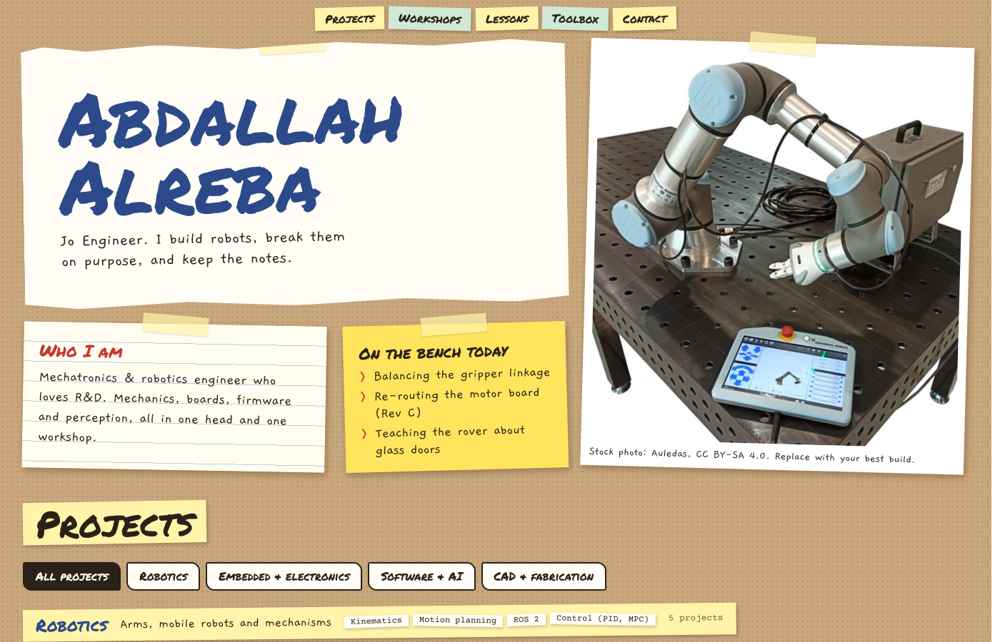
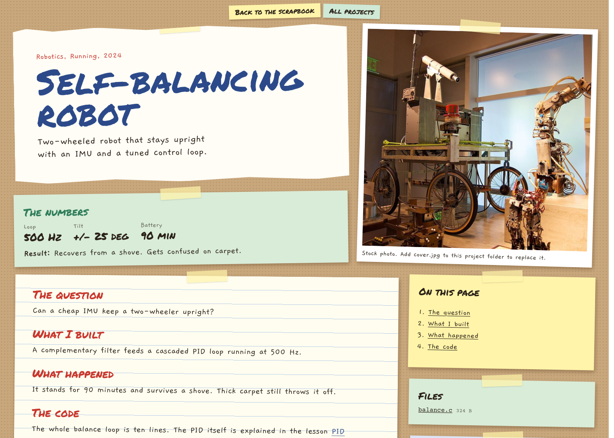
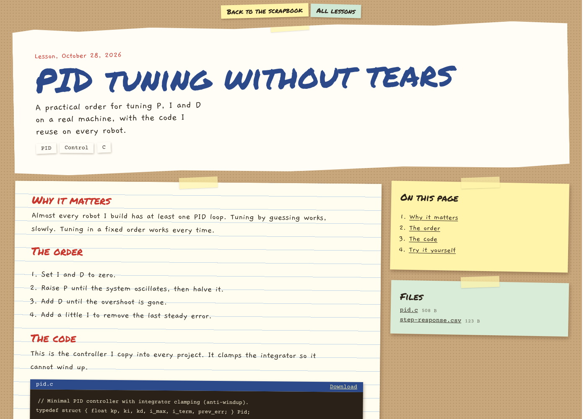

# Jo Engineer: portfolio and notes

**Live site: https://joengineer656.github.io/portfolio/**

Portfolio of Abdallah Alreba (Jo Engineer), mechatronics and robotics engineer. One site with two jobs:

- **Projects**: every project page is its full documentation, with write-up, photos, YouTube videos, code files and downloads.
- **Lessons**: how-tos, theory and tool tips that are not tied to one project.



| Project documentation | A lesson |
|---|---|
|  |  |

## How it works

Everything you write is a folder in `content/`. Add a folder to add a page, delete it to remove it.

```
content/
  projects/<name>/index.mdx    + cover.jpg, photos, code, CAD, PDFs
  lessons/<name>/index.mdx     + the same kinds of files
  moments/<name>/index.md      + photo.jpg   (workshops and challenges)
  site.ts                      name, bio, links, categories, skills
```

Inside `index.mdx` you write Markdown plus four extras:

```mdx
<Photo file="01-wiring.jpg" caption="Wiring" />
<YouTube url="https://youtu.be/XXXXXXXXXXX" />
<Code file="balance.c" />
<File file="chassis.step" label="Chassis CAD" />
```

Every `## heading` becomes a link in an **On this page** box, and every file in the folder is listed in a **Files** box.

## Run it

```bash
npm install
npm run dev        # http://localhost:3000
npm run build      # check everything is healthy
```

Pushing to `main` builds a static copy (`npm run build:pages`) and publishes it with GitHub Actions.

## Built with

Next.js 15, React 19, TypeScript, MDX (`next-mdx-remote`) and `gray-matter`. No database and no server.

The full guide for adding and editing content is `DOCUMENTATION.html` in the project folder.

Stock photos on the site are credited in `content/stock-credits.json`. Replace them with your own as you build.
